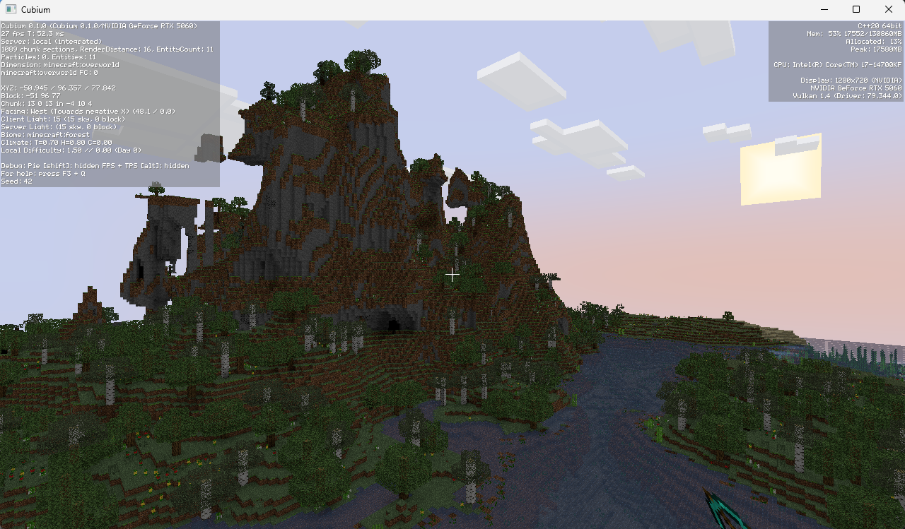
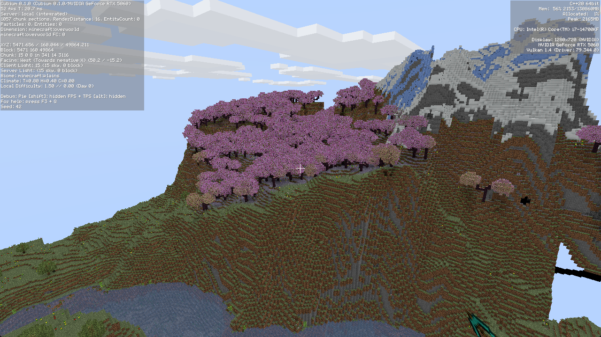

# Cubium





现代 Minecraft 第三方完整实现，使用 C++20 和 Vulkan 渲染，采用客户端-服务端架构。

## 初始化项目

详细的初始化指引见 docs/SETUP.md

## 构建

详细的构建指南见 [docs/BUILD.md](docs/BUILD.md)，包含环境配置、构建命令、运行方式、着色器编译、VS Code IntelliSense 配置、本地 Sanitizer 构建等。

## 运行服务端

### Windows / Linux

直接运行构建产物：

```bash
./build/bin/RelWithDebInfo/minecraft-server --help
```

### 交互式终端

加上 `--interactive` 可在终端里得到 Claude Code 式界面：左侧滚动日志、右侧实时状态面板、底部命令输入框
（`/` 开头执行命令，其它文本视为聊天广播；Tab 补全、↑/↓ 历史、PgUp/PgDn 与滚轮回看日志、Ctrl+Q 退出）。
右侧面板展示 TPS/tick 耗时/在线玩家/区块/实体与内存（一位小数 + MiB）；点击面板上的
`[refresh panel]`（或输入 `/panel`）刷新世界状态摘要（区块状态、方块与群系分布），
`/panel block|biome <x> <y> <z>`、`/panel places [数量]` 可查看具体方块/群系。

```bash
./build/bin/RelWithDebInfo/minecraft-server --interactive --profiler_enabled=false
```

该模式要求 stdin 与 stdout 都是交互式终端：显式开启但输出被重定向时报错退出（默认不带此 flag 时行为完全不变）。
`--gametest` / `--benchmark-exit-after-*` 等无头模式会忽略该 flag。

### macOS

macOS 上 Vulkan 加载器（vcpkg 打包的 `libvulkan`）默认不会发现 Homebrew 安装的 MoltenVK 驱动，必须通过 `VK_ICD_FILENAMES` 指向 ICD 清单，否则 `vkCreateInstance` 会返回 `-9`（`VK_ERROR_INCOMPATIBLE_DRIVER`）。启动命令：

```bash
# 方式 A：作为命令前缀（仅对本次启动生效）
VK_ICD_FILENAMES=/opt/homebrew/etc/vulkan/icd.d/MoltenVK_icd.json build/bin/RelWithDebInfo/minecraft-server

# 方式 B：先 export 再运行（当前 shell 后续都生效）
export VK_ICD_FILENAMES=/opt/homebrew/etc/vulkan/icd.d/MoltenVK_icd.json
build/bin/RelWithDebInfo/minecraft-server
```

> 注意：`VAR=value;` 单独一行（带分号、另起一行再运行二进制）只会设置 shell 变量而**不会**导出给子进程，进程仍然读不到该变量，会再次报 `-9`。请用上面两种写法之一。
>
> MoltenVK 经 Homebrew 安装时，ICD 清单路径为 `/opt/homebrew/etc/vulkan/icd.d/MoltenVK_icd.json`；若改用 Vulkan SDK 安装，路径见 SDK 目录下的 `share/vulkan/icd.d/`。

> **说明**：项目目前以服务端为主，Linux/macOS 的默认 preset 均设 `MC_BUILD_CLIENT=OFF`。客户端构建已关闭，如需构建客户端请使用 Windows preset（`windows-clang-*`，设 `MC_BUILD_CLIENT=ON`）。

## 测试

项目测试基于 GoogleTest，通过 CTest 编排运行，支持单用例限时（默认 300 秒）、并行、按名筛选。完整指南见 docs/test/UNIT_TEST.md。

端到端 bot 测试（以 mineflayer 作为真实 wire 客户端连服务端，并可与原版服务端双跑对比）见 docs/test/E2E_BOT_TEST.md。

机器人压力测试（多档速度串行移动、大量发包、大量玩家加入，含内存与 tick 耗时报告）见 [docs/test/STRESS_TEST.md](docs/test/STRESS_TEST.md)。

协议模糊测试（libFuzzer harness，对"入站字节 → IR 包"解码链路做覆盖率引导测试）见 docs/test/FUZZING.md。

性能基准测试（google/benchmark：区块生成吞吐、光照引擎、服务端启动耗时，含内存指标与 Perfetto trace）见 docs/BENCHMARK.md。

持续集成（每晚自动跑一次完整测试并产出服务端 nightly build）见 [docs/CI.md](docs/CI.md)。

## clang-tidy 静态分析

见 docs/TIDY.md

## 依赖

见vcpkg.json
