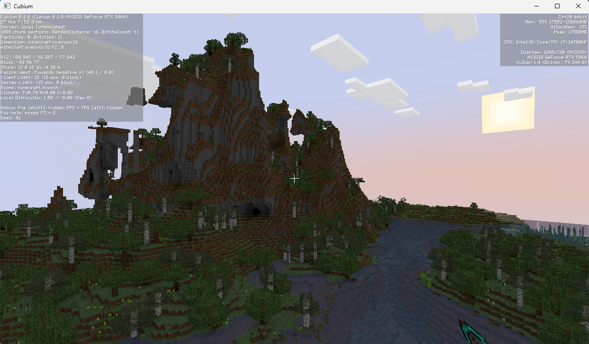
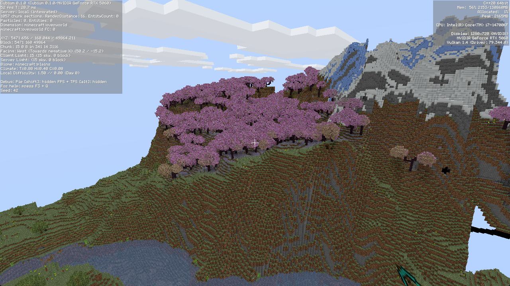

# Cubium





现代 Minecraft 第三方完整实现，使用 C++20 和 Vulkan 渲染，采用客户端-服务端架构。

## 初始化项目

详细的初始化指引见 docs/SETUP.md

## 构建

详细的构建指南见 [docs/BUILD.md](docs/BUILD.md)，包含环境配置、构建命令、运行方式、着色器编译、VS Code IntelliSense 配置、本地 Sanitizer 构建等。

## 运行服务端

### Windows / Linux

直接运行构建产物：

```bash
./build/bin/RelWithDebInfo/minecraft-server --help
```

### 交互式终端

加上 `--interactive` 可在终端里得到 Claude Code 式界面：左侧滚动日志、右侧实时状态面板、底部命令输入框
（`/` 开头执行命令，其它文本视为聊天广播；Tab 补全、↑/↓ 历史、PgUp/PgDn 与滚轮回看日志、Ctrl+Q 退出）。
右侧面板展示 TPS/tick 耗时/在线玩家/区块/实体与内存（一位小数 + MiB）；点击面板上的
`[refresh panel]`（或输入 `/panel`）刷新世界状态摘要（区块状态、方块与群系分布），
`/panel block|biome <x> <y> <z>`、`/panel places [数量]` 可查看具体方块/群系。

```bash
./build/bin/RelWithDebInfo/minecraft-server --interactive --profiler_enabled=false
```

该模式要求 stdin 与 stdout 都是交互式终端：显式开启但输出被重定向时报错退出（默认不带此 flag 时行为完全不变）。
`--gametest` / `--benchmark-exit-after-*` 等无头模式会忽略该 flag。

### macOS

默认服务端不依赖 Vulkan、GLFW 或 OpenAL。使用 `macos-relwithdebinfo-server` 构建后，
直接运行 `build/bin/RelWithDebInfo/minecraft-server`。
显式启用客户端时才需要 MoltenVK 等图形运行环境，配置见 `docs/BUILD.md`。

## 测试

项目测试基于 GoogleTest，通过 CTest 编排运行，支持单用例限时（默认 300 秒）、并行、按名筛选。完整指南见 docs/test/UNIT_TEST.md。

端到端 bot 测试（以 mineflayer 作为真实 wire 客户端连服务端，并可与原版服务端双跑对比）见 docs/test/E2E_BOT_TEST.md。

机器人压力测试（多档速度串行移动、大量发包、大量玩家加入，含内存与 tick 耗时报告）见 [docs/test/STRESS_TEST.md](docs/test/STRESS_TEST.md)。

协议模糊测试（libFuzzer harness，对"入站字节 → IR 包"解码链路做覆盖率引导测试）见 docs/test/FUZZING.md。

性能基准测试（google/benchmark：区块生成吞吐、光照引擎、服务端启动耗时，含内存指标与 Perfetto trace）见 docs/BENCHMARK.md。

持续集成（每晚自动跑一次完整测试并产出服务端 nightly build）见 [docs/CI.md](docs/CI.md)。

## clang-tidy 静态分析

见 docs/TIDY.md

## 依赖

见vcpkg.json
