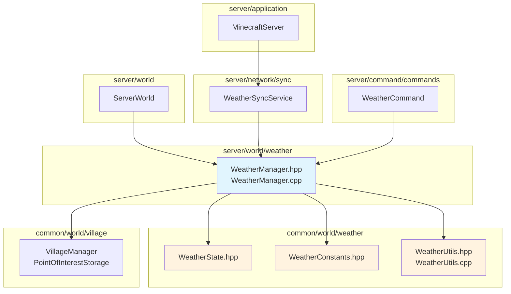

# WeatherManager 模块

服务端天气管理系统，负责管理世界天气状态、天气周期 tick 更新、闪电生成和天气同步通知。

## 目录结构

```
src/server/world/weather/
├── WeatherManager.hpp   # 服务端天气管理器头文件
└── WeatherManager.cpp   # 服务端天气管理器实现
```

## 模块关系图



## 上下游依赖关系

### 外部依赖

| 依赖 | 用途 |
|------|------|
| `common/world/weather/WeatherState.hpp` | 天气状态数据结构 |
| `common/world/weather/WeatherConstants.hpp` | 天气常量定义 |
| `common/world/weather/WeatherUtils.hpp` | 天气工具函数 |
| `common/util/math/random/Random.hpp` | 随机数生成器 |
| `common/core/Result.hpp` | 错误处理 |
| `common/world/IWorld.hpp` | 世界接口（前向声明） |
| `common/world/village/VillageManager.hpp` | 通过 POI 存储搜索避雷针 |
| `common/entity/core/LivingEntity.hpp` | 闪电目标实体过滤 |

### 被依赖

| 模块 | 用途 |
|------|------|
| `ServerWorld` | 持有 WeatherManager 实例，调用 tick() 与逐区块闪电判定 |
| `WeatherSyncService` | 按维度读取强度并广播 |
| `WeatherCommand` | 执行 `/weather` 命令（固定主世界） |

## 容易踩的坑

### 1. 强度阈值判断

使用 `raining` 标志而不是 `isRaining()` 判断天气状态会导致错误。`isRaining()` 检查 `rainStrength > 0.2`，这比直接检查 `raining` 标志更准确，因为强度渐变有延迟。`isThundering()` 用 `雷暴强度 × 降雨强度 > 0.9`，与 `Level.getThunderLevel` 一致。

### 2. DELAY 与 DURATION 不能混用

`rainTime`/`thunderTime` 耗尽后的重置区间取决于当前状态：正在下雨/雷暴时用 DURATION（10-20 分钟 / 3-13 分钟），否则用 DELAY（10-150 分钟）。把 DURATION 用于等待阶段会让天气变化过于频繁。

### 3. 天气变化检测时机

在 `tick()` 之前检查 `hasWeatherChanged()` 可能错过上一帧的变化。正确做法是先 tick 再检查。

### 4. 无天气能力的维度

`canHaveWeather() == false`（下界/末地）时不推进周期、不渐变强度，且 `isRaining()/isThundering()/weatherType()` 恒为晴天。`ServerWorld::initialize` 按 `hasSkyLight && !hasCeiling && 不是末地` 设置。

### 5. clearWeatherTime 强制晴天

当 `clearWeatherTime > 0` 时，天气周期不会自然变化；该分支会把 rain/thunder 计时器压到 0/1 并清除标志。`resetWeather()`（睡觉）只清计时器与标志，不清 `clearWeatherTime`。

### 6. 命令缺省时长

`setClear(0)`/`setRain(0)`/`setThunder(0)` 分别按 `RAIN_DELAY`/`RAIN_DURATION`/`THUNDER_DURATION` 采样。`/weather` 命令固定作用于主世界，不随执行者维度变化。

### 7. 闪电必须逐区块判定

原版 `ServerLevel.tickThunder` 由 `ServerChunkCache.tickSpawningChunk` 对每个实体 ticking 区块调用，即每区块每 tick 1/100000；不要在 ServerWorld 层只做一次全局判定。随机列必须用 `ServerWorld::getBlockRandomPos`（世界 LCG），落点由 `WeatherManager::findLightningTarget` 计算：优先 128 格内位于世界表面的避雷针，其次 3 格膨胀柱状范围内的可见天空 LivingEntity。

### 8. 存档恢复走 restoreState

天气状态只通过 `level.dat` 的 `clearWeatherTime/rainTime/raining/thunderTime/thundering`
恢复；不存在独立的二进制序列化路径。`applyLevelRuntimeData` 必须使用 `restoreState`
（按原版 `prepareWeather` 直接把强度置 0/1），不要调用 `setClear/setRain/setThunder`，
否则会把 `clearWeatherTime=0` 误当成"强制晴天"并重置计时器。
